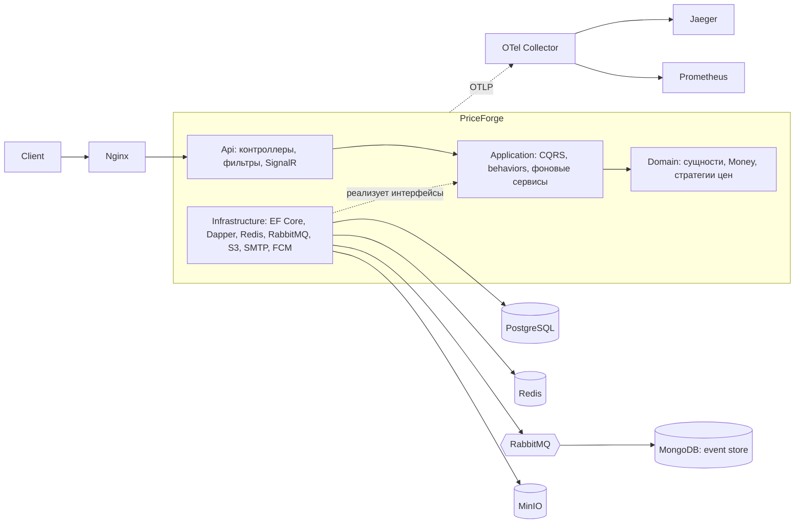

# PriceForge

[](https://github.com/Platonovv/AspPriceForge/actions/workflows/ci.yml)

Бэкенд интернет-магазина с гибким ценообразованием на ASP.NET Core 8: каталог товаров с составом (BOM), расчёт цены по правилам, акции и промокоды, корзина и заказы, поиск, уведомления. Учебный проект, собранный по прод-практикам: Clean Architecture, CQRS, Transactional Outbox, наблюдаемость, интеграционные тесты на реальных контейнерах, CI и манифесты Kubernetes.

**Стек:** .NET 8 · ASP.NET Core · EF Core 8 + PostgreSQL · Dapper · MediatR · FluentValidation · Redis · RabbitMQ · MongoDB · MinIO (S3) · SignalR · Serilog + Elasticsearch/Kibana · OpenTelemetry → Jaeger / Prometheus / Grafana · xUnit · Testcontainers · Docker · Kubernetes · GitHub Actions

## Возможности

- **Каталог:** товары, SKU, состав изделия (дерево компонентов), категории, изображения в S3 (MinIO) с фоновой очисткой неиспользуемых файлов.
- **Цены:** расчёт по стратегиям (VIP-скидка, оптовая скидка), уровни клиентов, акции на товар и категорию с периодом действия, промокоды, история изменений цены.
- **Поиск:** фильтры, сортировка и пагинация по заранее рассчитанной публичной цене — её обновляет фоновый сервис, а не каждый запрос.
- **Корзина и заказы:** оформление заказа в одной транзакции.
- **Отчёты:** потоковая выгрузка CSV через Dapper и `IAsyncEnumerable` — отчёт не собирается в памяти целиком.
- **Пользователи:** регистрация, подтверждение email, сброс пароля, роли и политики авторизации.
- **Уведомления:** realtime-обновление цен через SignalR, email (MailKit) и push (FCM) за общим интерфейсом `INotificationChannel`.

## Архитектура



Зависимости направлены внутрь, к `Domain`; инфраструктура подключается только через интерфейсы слоя `Application`. Диаграммы потока запроса и публикации событий — в [docs/architecture.md](docs/architecture.md).

## Ключевые решения

Каждое крупное решение с альтернативами и ценой записано в [ADR](docs/adr).

**Дерево состава — closure table** ([ADR-001](docs/adr/001-closure-table.md)). Нагрузка read-heavy: состав меняется редко, читается часто. Вместо adjacency list с рекурсивным CTE на каждое чтение хранится таблица всех пар «предок → потомок» с глубиной. Связи поддерживаются в `SaveChangesAsync` одной вставкой `INSERT … SELECT … CROSS JOIN`, а любая ветка на любой глубине читается одним индексированным запросом без рекурсии. Цена решения — дороже запись и больше строк.

**Clean Architecture + CQRS на MediatR** ([ADR-002](docs/adr/002-cqrs-mediatr.md), [ADR-005](docs/adr/005-clean-architecture.md)). Каждый сценарий — отдельная команда или запрос со своим обработчиком. Сквозная логика вынесена в pipeline behaviors: валидация (FluentValidation), логирование, кэширование запросов в Redis. Отчёты читаются через Dapper в обход EF.

**Ценообразование на паттернах.** Правила цены — реализации `IPricingStrategy`, условия — композируемые спецификации (`And` / `Or` / `Not`); новое правило добавляется отдельным классом без правок калькулятора. Деньги — value object `Money` с валютой и правилами округления. Расчёт цены — **21,8 нс и 80 Б аллокаций на вызов** ([BenchmarkDotNet](benchmarks/PriceForge.Benchmarks)).

**Надёжная доставка событий — Transactional Outbox** ([ADR-003](docs/adr/003-outbox.md)). Изменение данных и событие пишутся в одной транзакции; `OutboxDispatcher` пачками публикует их в RabbitMQ. Топология: retry-очередь с TTL и счётчиком попыток, dead-letter queue для «ядовитых» сообщений, alternate exchange для непромаршрутизированных событий. Доставка at-least-once, консьюмер идемпотентен (уникальный ключ в MongoDB), запись в Mongo обёрнута в Polly retry.

**Идемпотентность и конкурентность.** `Idempotency-Key` для небезопасных запросов: ответ кэшируется в Redis по пользователю и маршруту, параллельный повтор с тем же ключом получает 409 через распределённую блокировку. Оптимистичная блокировка товара по системной колонке PostgreSQL `xmin`: конфликт превращается в 409, а не в потерянное обновление.

**Аутентификация — JWT access + refresh** ([ADR-004](docs/adr/004-jwt-refresh.md)). Короткий access-токен и ротация refresh-токена при каждом обновлении. Выход отзывает access-токен по `jti` (denylist в Redis), сброс пароля отзывает все токены пользователя. Пароли — BCrypt, токены из писем хранятся хэшами. Вход ограничен по IP (`RateLimiter`) и по аккаунту (счётчик попыток в Redis); снаружи — nginx reverse proxy.

**Наблюдаемость.** Структурные логи Serilog в Elasticsearch (Kibana) с correlation id, трассировка и метрики OpenTelemetry через OTel Collector в Jaeger и Prometheus, Grafana для графиков, health checks `/health/live` и `/health/ready` (PostgreSQL, Redis). Ошибки отдаются в формате ProblemDetails.

## Быстрый старт

Нужен Docker.

```bash
cp .env.example .env          # заполнить пароли, JWT_SECRET, при необходимости SMTP
docker compose up -d --build
```

- API: http://localhost:8080 (через nginx — http://localhost:8088), Swagger — в окружении Development
- Health: http://localhost:8080/health/ready
- Jaeger — 16686, Grafana — 3000, Prometheus — 9090, Kibana — 5601, RabbitMQ UI — 15672

Для push-уведомлений нужен ключ сервисного аккаунта Firebase (путь — в `compose.yaml`). Готовые запросы — коллекция Postman в `postman/`.

## Тесты

```bash
dotnet test
```

144 теста: 52 unit (домен, стратегии, обработчики) и 92 интеграционных и E2E. Интеграционные поднимают настоящие PostgreSQL, Redis и MinIO через Testcontainers, API — через `WebApplicationFactory`, база между тестами чистится Respawn. Покрыты авторизация и отзыв токенов, лимиты входа, идемпотентность, заказы, акции и промокоды, поиск, изображения, email-сценарии, CORS и контракт OpenAPI.

## CI

GitHub Actions ([ci.yml](.github/workflows/ci.yml)) на каждый push и PR:

1. сборка и все тесты;
2. проверка контракта: `openapi.json` сравнивается с предыдущей версией (oasdiff), ломающие изменения API валят сборку;
3. на `main` — сборка Docker-образа и публикация в GitHub Container Registry.

## Kubernetes

Манифесты в [`k8s/`](k8s): API — Deployment на 3 реплики с readiness/liveness-пробами и Service; PostgreSQL, Redis, RabbitMQ, MongoDB; настройки через ConfigMap и Secret. Миграции — отдельный Job из EF Core bundle, а не при старте каждой реплики. SignalR масштабируется через Redis backplane.

```bash
kubectl apply -f k8s/configmap.yaml -f k8s/secret.yaml
kubectl apply -f k8s/postgres.yaml -f k8s/redis.yaml -f k8s/rabbitmq.yaml -f k8s/mongo.yaml
kubectl apply -f k8s/migrate-job.yaml
kubectl apply -f k8s/api.yaml
```

`k8s/secret.yaml` в репозиторий не входит: создаётся локально (`kubectl create secret`) с ключами из `configmap.yaml` и `.env.example`.

## Структура

```
src/
  PriceForge.Domain          сущности, value objects, стратегии и спецификации цен
  PriceForge.Application     команды и запросы, behaviors, фоновые сервисы, интерфейсы
  PriceForge.Infrastructure  EF Core, Dapper, Redis, RabbitMQ, MongoDB, S3, SMTP, FCM
  PriceForge.Api             контроллеры, фильтры, middleware, SignalR, composition root
tests/                       unit и интеграционные тесты
benchmarks/                  BenchmarkDotNet
docs/                        архитектура и ADR
k8s/                         манифесты Kubernetes
```

Конфигурация — через переменные окружения (12-factor), список ключей — в [`.env.example`](.env.example). Секреты в репозиторий не попадают.
