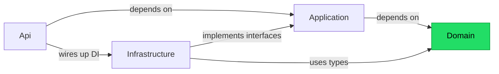
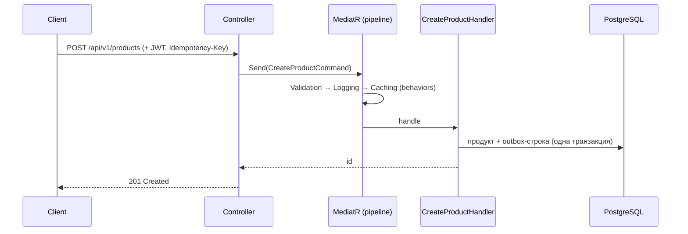
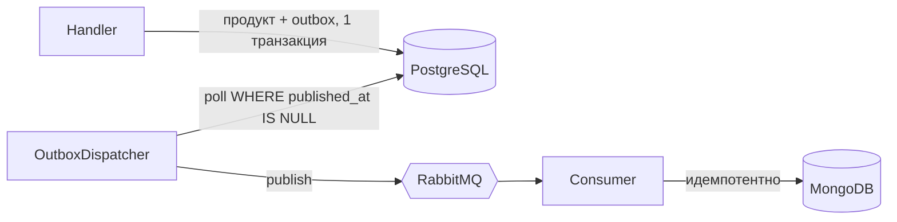

# Архитектура

## Слои (Clean Architecture)

Зависимости текут только внутрь, к `Domain`. `Domain` не зависит ни от чего; внешние слои зависят от внутренних.

- **Domain** — сущности, value objects, инварианты (ни от чего не зависит).
- **Application** — use cases (CQRS) + интерфейсы инфраструктуры.
- **Infrastructure** — реализации (EF / Redis / RabbitMQ / SMTP / JWT).
- **Api** — HTTP, middleware, composition root.

## Поток запроса (создание товара)

## Публикация событий (Outbox)

Гарантия доставки — at-least-once; консьюмер идемпотентен (дедуп по ключу).
